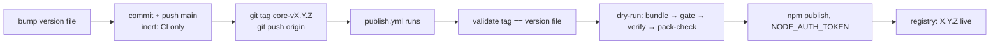

# Releasing — "say release, then walk off"

Two independent trains, one trigger each:

| train | version file | tag | npm package |
|---|---|---|---|
| core | `packages/core/package.json` | `core-vX.Y.Z` | `@sanityloop/core` |
| extras | `packages/extras/shelf.json` | `extras-vX.Y.Z` | `@sanityloop/extras` |

Extras declares a core **range** (`"core": "^0.2.0"` in `shelf.json`), never a lockstep
copy — bump core only when core itself changed.

## The contract

- **A push to main is inert.** It runs `ci.yml` (verify: typecheck → unit → e2e →
  templates → live) and nothing else. It never touches npm.
- **A tag push is the release.** `core-vX.Y.Z` / `extras-vX.Y.Z` runs `publish.yml`,
  which validates the tag against that package's own version file, dry-runs the
  staged publish, then publishes **only that train**.
- **"release" = run the command, don't ask.** No manual `npm publish`, ever, from any
  machine. CI owns publishing; the repo's only job is to hand it the right commit
  and the right tag.



## Commands

```bash
npm run release:core   -- --patch      # 0.2.3 → 0.2.4: bump, commit, push, tag, push tag
npm run release:extras -- --minor
npm run release:core   -- --to 0.3.0   # exact version
npm run release:core   -- --dry-run    # prints the plan, changes nothing
```

`scripts/release.ts` refuses a dirty tree, bumps that package's version file,
syncs the lockfile for core, commits, pushes main, then tags and pushes the tag.

If the versions are **already bumped** (e.g. the bump landed in a feature commit),
the release is just the tags:

```bash
git tag core-v0.2.3   && git push origin core-v0.2.3
git tag extras-v0.2.4 && git push origin extras-v0.2.4
```

## Verify without gh

```bash
# 1. runs (no auth needed, public repo)
curl -s "https://api.github.com/repos/lirrensi/SanityLoop/actions/runs?per_page=6" \
  | grep -E '"(name|head_branch|head_sha|status|conclusion)"'

# 2. the artifact — authoritative, no cache games
curl -s -o /dev/null -w "%{http_code}\n" https://registry.npmjs.org/@sanityloop%2Fcore/0.2.3
curl -s -o /dev/null -w "%{http_code}\n" https://registry.npmjs.org/@sanityloop%2Fextras/-/extras-0.2.4.tgz

# 3. dist-tags (may lag a minute behind a publish)
curl -s "https://registry.npmjs.org/@sanityloop%2Fextras?cb=$RANDOM" | grep -o '"latest":"[^"]*"'
```

A `404` on the version endpoint right after a green publish is replication lag —
re-check in a minute. `npm view` on this machine is slow and cache-happy; prefer the
URLs above (`--prefer-online` if you must use the CLI).

## Troubleshooting — the failures already paid for

| Symptom | Cause | Fix |
|---|---|---|
| `! [remote rejected] main -> main (refusing to allow a Personal Access Token to create or update workflow … without 'workflow' scope)` | the stored PAT lacks `workflow`, and some commit in the pushed range edits `.github/workflows/**` — GitHub rejects the **whole** push, branch and tag alike | store a PAT with `repo` + `workflow` (one-liner below), then push again |
| "nothing on npm", no tag, release "pending" for days | the commits were never pushed: `git rev-list --count origin/main..main` says > 0 | push first — a tag cannot publish a commit GitHub has never seen |
| Publish run fails at *Verify the publish artifacts* with no message | a wrapped child process failed and its stdout was thrown away (pre-`cd95fcc`) | fixed: `run()` now prints captured stdout. Historical cause: gate tsconfig `target`/`lib` drift → `TS2550 Promise.withResolvers` |
| Publish run red at *Resolve the release*: `tag … does not match … version` | tag version ≠ the package's version file | bump the file, commit, push, re-tag |
| `npm view` shows the old version after a green publish | registry CDN + npm CLI cache | use the endpoint checks above |

### Re-tagging a commit that is broken

Legitimate only while the version was **not** published (a red run publishes nothing):

```bash
git tag -d extras-v0.2.4 && git push --delete origin extras-v0.2.4
git tag extras-v0.2.4   && git push origin extras-v0.2.4
```

## One-time prerequisites (done 2026-10-18)

- **repo secret `NPM_TOKEN`** — npm granular *automation* token with publish access and
  bypass-2FA. The workflow already requests `id-token: write`; trusted publishing (OIDC)
  is the eventual replacement, the token is the bootstrap.
- **git credential with `workflow` scope**, otherwise no push touching
  `.github/workflows/**` can ever land:
  ```bash
  printf "protocol=https\nhost=github.com\nusername=lirrensi\npassword=PASTE_NEW_TOKEN\n\n" | git credential approve
  ```
- **commit identity** — `git config --global user.email 195659793+lirrensi@users.noreply.github.com`.
  Commits authored `*@example.com` are invisible to GitHub: gray Octocat, no contribution
  graph, until they are rewritten.

## History

- **2026-10-18** — first release through this flow: `@sanityloop/core 0.2.3`
  (run 39127819742), `@sanityloop/extras 0.2.4` (run 39128416559). Before it, nothing had
  been pushed since 2026-10-17, so no tag could exist and npm sat still for weeks; extras
  then failed once on the gate tsconfig drift (fixed in `cd95fcc`, which also made the
  gate inherit `target`/`lib` from `tsconfig.base.json`).
